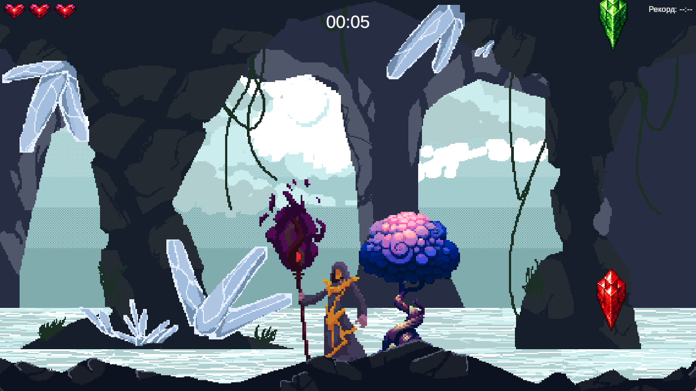
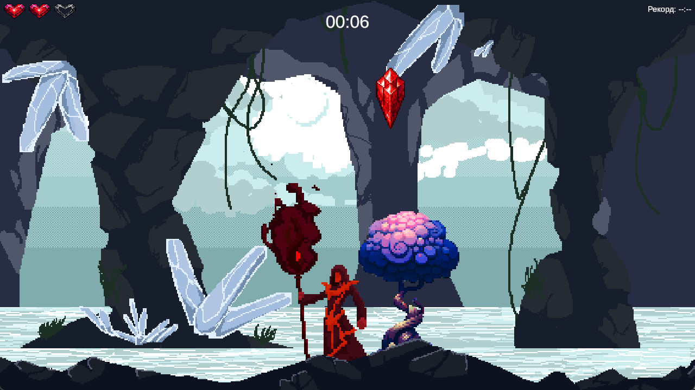
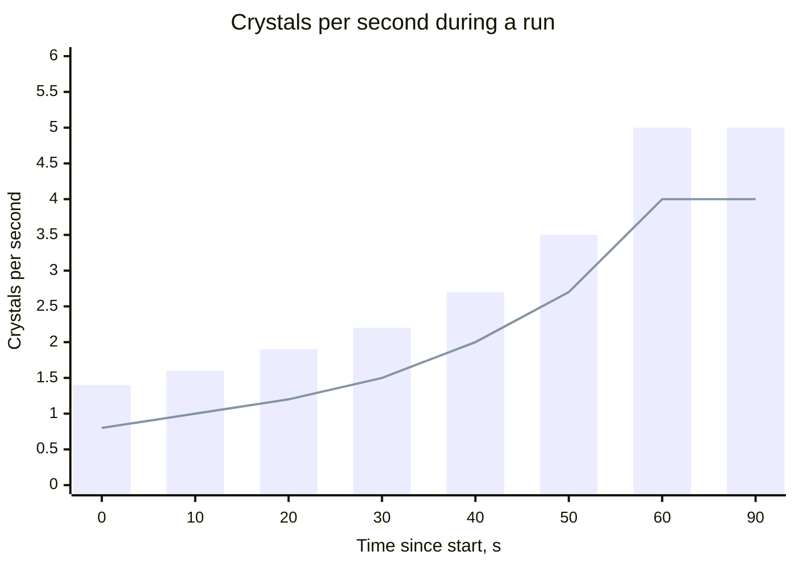
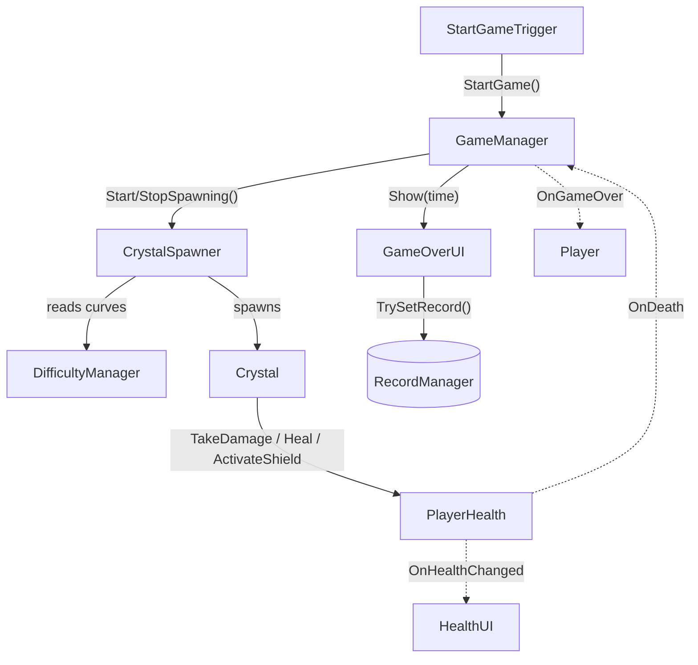
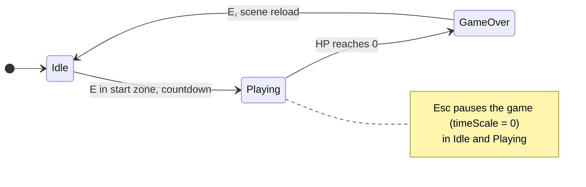
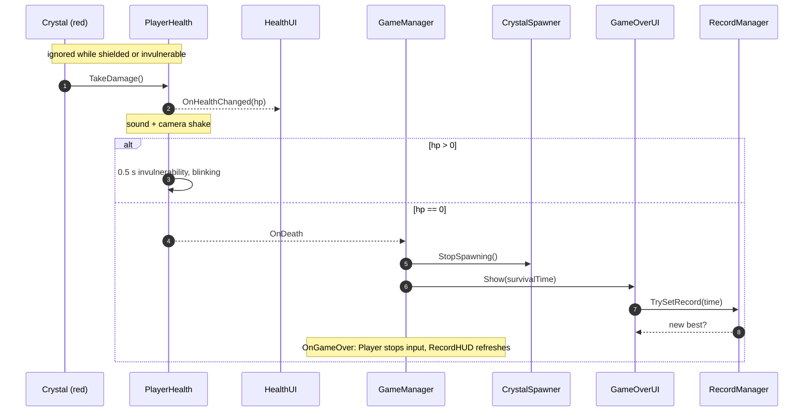
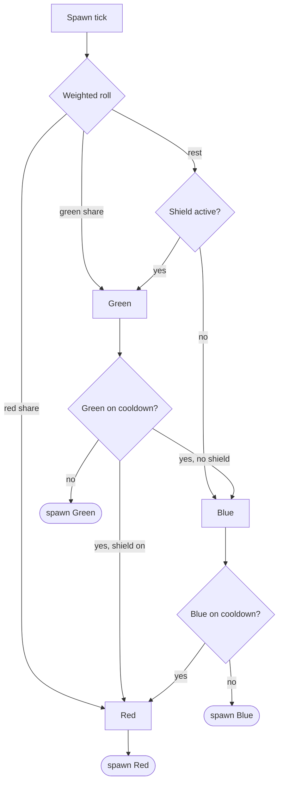

<div align="center">

# Crystal Fall

**2D pixel-art arcade survival game made with Unity 6.**<br>
Dodge red crystals, catch green and blue ones, survive as long as you can.

[](https://github.com/Zekrom1221/crystal-fall/releases/latest)
[](LICENSE)


[](https://github.com/Zekrom1221/crystal-fall/releases/latest)

**English** · [Русский](README.ru.md)

[Gameplay](#gameplay) · [Controls](#controls) · [Architecture](#architecture) · [Building](#building-from-source) · [Credits](#credits)



</div>

> [!NOTE]
> Third-party art and sound effects are not included in this repository: their licenses don't allow redistributing the files. The playable build in [Releases](https://github.com/Zekrom1221/crystal-fall/releases/latest) has everything, and [Credits](#credits) lists where each pack comes from.

## Features

- Three crystal types: red ones hurt, green ones heal, blue ones give a shield
- Difficulty ramps up over the first minute: crystals fall more often and more of them are red
- The spawner uses cooldowns, so the same bonus can't drop again too soon
- Survival timer and a best-time record saved between sessions
- Pause menu, everything is played on the keyboard
- Pixel-art cave with 2D lighting and a parallax background

## About

Solo project, built over several months while learning Unity from scratch. The hardest part was understanding how Unity itself works: components, the MonoBehaviour lifecycle (`Awake`, `Start`, `Update`…) and its API. Along the way I significantly improved my C# and my understanding of game development in general.

## Gameplay

Crystals fall from the ceiling of a cave. Walk into the start zone and press <kbd>E</kbd>: after a 3-2-1 countdown the run begins. Your score is the time you survive.

| | Crystal | Effect |
|:-:|---------|--------|
| 🔴 | Red   | −1 HP (you have 3). After a hit you get 0.5 s of invulnerability with a blink and a camera shake |
| 🟢 | Green | +1 HP, up to the maximum |
| 🔵 | Blue  | Shield for 3 seconds, red crystals don't hurt |

<p align="center">
  <br>
  <sub>Taking a hit: the wizard flashes red and one heart is gone.</sub>
</p>

### Difficulty curve

The spawn interval goes down linearly from 0.7 s to 0.2 s over the first 60 seconds, so the number of crystals per second grows faster and faster. At the same time the share of red crystals rises from 55% to 80%.



<sub>Bars: all crystals. Line: red crystals by their base weight (cooldown swaps make the real number slightly higher). After 60 s the curve stays flat.</sub>

Bonuses also get rarer: the minimum gap between two green (or two blue) crystals stays at 1.5 s for the first minute and a half, then grows by 1 s per minute, up to 10 s.

The numbers above are the values tuned in the `Game` scene; the defaults in the scripts differ.

## Controls

| Key | Action |
|-----|--------|
| <kbd>A</kbd> <kbd>D</kbd> | Move |
| <kbd>E</kbd> | Start the run (in the start zone), restart after game over, confirm in the pause menu |
| <kbd>Esc</kbd> | Pause / resume |
| <kbd>W</kbd> <kbd>S</kbd> | Navigate the pause menu |

The in-game UI is in Russian.

## Tech stack

| Area | Used |
|------|------|
| Engine | Unity 6 (6000.3.8f1), C# |
| Rendering | Universal Render Pipeline 2D, 2D lights |
| Camera | Cinemachine 2 with a custom `CinemachineExtension` |
| Input | Input System with a generated C# wrapper |
| UI | uGUI + TextMeshPro |

## Architecture

The game is a set of MonoBehaviours wired together in one scene. They talk through direct method calls and C# events.



<sub>Solid arrows are method calls, dotted arrows are C# events. Not shown: `TimerUI`, `RecordHUD`, `PauseManager` and the camera scripts.</sub>

- **GameManager**: singleton with a three-state machine. Starts and stops the spawner, tracks survival time, raises `OnGameStart` / `OnGameOver`.
- **PlayerHealth**: HP, invulnerability frames and shield. Exposes C# events (`OnHealthChanged`, `OnShieldChanged`, `OnDeath`) instead of being polled: `HealthUI` listens to health changes, `GameManager` to death.
- **DifficultyManager**: every difficulty parameter is a function of elapsed time (linear interpolation over `rampDuration`), so balancing is done in the Inspector without touching code.
- **CrystalSpawner**: weighted random choice with cooldowns, see the diagram below.
- **CinemachineClamp**: custom `CinemachineExtension` that keeps the camera inside the level bounds. **ParallaxLayer** handles the multi-layer background.
- **RecordManager**: best time stored in `PlayerPrefs`.
- **BuildScript** (Editor): validates scenes (missing scripts, broken references) and builds the Windows player from the command line.

<details>
<summary><b>Game states</b></summary>



</details>

<details>
<summary><b>What happens when a red crystal hits the player</b></summary>



</details>

<details>
<summary><b>How the spawner picks a crystal</b></summary>



The red share comes from `DifficultyManager`, green takes 55% of the rest. While the shield is active, no blue crystals spawn.

</details>

<details>
<summary><b>Project structure</b></summary>

```
Assets/
├── Scenes/Game.unity       the only scene
├── Scripts/
│   ├── Camera/             Cinemachine clamp, parallax, camera shake
│   ├── Crystals/           crystal pickup, spawner
│   ├── Gameplay/           game state, difficulty, records, start trigger
│   ├── Input/              Input System actions + generated wrapper
│   ├── Player/             movement, health and shield
│   └── UI/                 HUD, pause menu, game over screen
├── Editor/BuildScript.cs   scene validation + headless build
├── Art/  Animations/  Prefabs/
└── ThirdParty/             not in the repository, see Credits
```

</details>

## Building from source

1. Install **Unity 6000.3.8f1** with *Windows Build Support* via Unity Hub.
2. Clone the repository and open the folder in Unity Hub.
3. Third-party art and audio are not included, so the scripts compile and the scene opens, but sprites and sounds are missing. To restore the visuals, import the packs from [Credits](#credits). Asset Store packages keep their original GUIDs, so scene references should reconnect after import.
4. Build via **Tools → Crystal Fall → Build Windows**. The build goes to `Builds/Windows/`.

> [!TIP]
> The build also runs headless, which is handy for CI:
> ```
> Unity.exe -batchmode -quit -projectPath . -executeMethod BuildScript.BuildWindows
> ```
> Use `-executeMethod BuildScript.ValidateFromCommandLine` to run only the scene check.

## Credits

| Asset | Author | Source |
|-------|--------|--------|
| Evil Wizard 2 (player character) | Luiz Melo | [Unity Asset Store](https://assetstore.unity.com/packages/2d/characters/evil-wizard-2-284501) |
| Pixel Art Gem Pack - Animated | karsiori | [Unity Asset Store](https://assetstore.unity.com/packages/2d/environments/pixel-art-gem-pack-animated-277559) |
| Fantasy Pixel Trees | EF Studio | [Unity Asset Store](https://assetstore.unity.com/packages/2d/environments/fantasy-pixel-trees-269458) |
| Free Crystal Cave Pixel Art Backgrounds | CraftPix.net | [craftpix.net](https://craftpix.net/freebies/free-crystal-cave-pixel-art-backgrounds/) |

All four packs are free. Sound effects were made with an online sound effect generator and are not included in the repository.

## License

The code is licensed under [MIT](LICENSE). Third-party assets belong to their authors and are not covered by this license.
