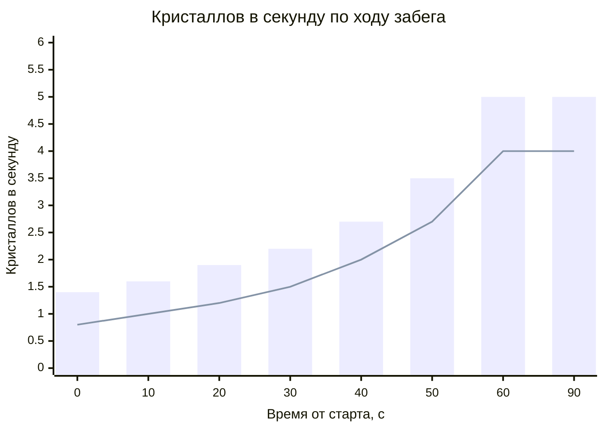
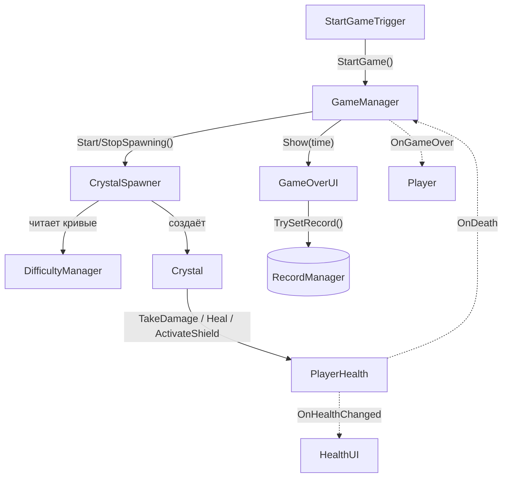
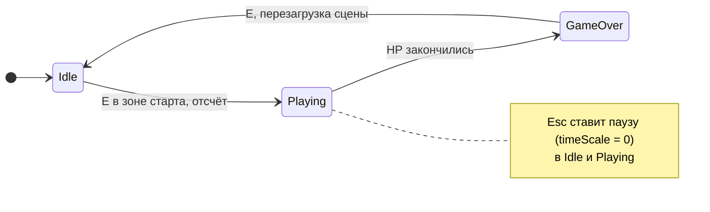
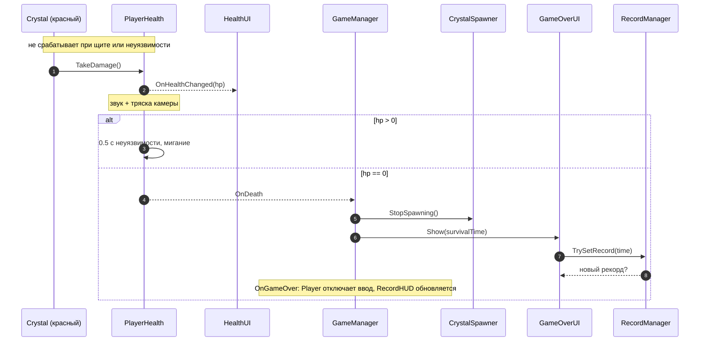
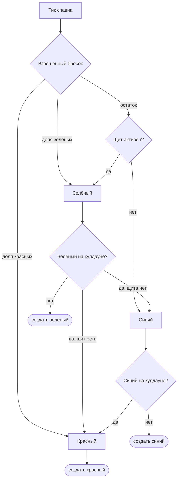

<div align="center">

# Crystal Fall

**Аркада на выживание в пиксель-арте на Unity 6.**<br>
Уворачивайся от красных кристаллов, лови зелёные и синие и продержись как можно дольше.

[](https://github.com/Zekrom1221/crystal-fall/releases/latest)
[](LICENSE)


[](https://github.com/Zekrom1221/crystal-fall/releases/latest)

[English](README.md) · **Русский**

[Геймплей](#геймплей) · [Управление](#управление) · [Архитектура](#архитектура) · [Сборка](#сборка-из-исходников) · [Авторы ассетов](#авторы-ассетов)


</div>

> [!NOTE]
> Сторонних спрайтов и звуков в репозитории нет: их лицензии запрещают выкладывать файлы. В билде из [Releases](https://github.com/Zekrom1221/crystal-fall/releases/latest) есть всё, а откуда каждый пак — в разделе [Авторы ассетов](#авторы-ассетов).

## Возможности

- Три вида кристаллов: красные ранят, зелёные лечат, синие дают щит
- Сложность растёт первую минуту: кристаллы падают чаще, и красных становится больше
- Спавнер с кулдаунами: один и тот же бонус не выпадет снова слишком скоро
- Таймер выживания и рекорд, который сохраняется между запусками
- Меню паузы, всё управление с клавиатуры
- Пиксельная пещера с 2D-освещением и параллакс-фоном

## О проекте

Соло-проект: делал его несколько месяцев, изучая Unity с нуля. Сложнее всего было разобраться, как устроен сам Unity: компоненты, жизненный цикл MonoBehaviour (`Awake`, `Start`, `Update`…) и его API. По ходу работы заметно прокачал C# и понимание геймдева в целом.

## Геймплей

С потолка пещеры падают кристаллы. Подойди к зоне старта и нажми <kbd>E</kbd>: после отсчёта 3-2-1 начинается забег. Очки — это время, которое ты продержался.

| | Кристалл | Эффект |
|:-:|----------|--------|
| 🔴 | Красный | −1 HP (всего их 3). После удара 0.5 с неуязвимости с миганием и тряской камеры |
| 🟢 | Зелёный | +1 HP, но не больше максимума |
| 🔵 | Синий   | Щит на 3 секунды, красные кристаллы не ранят |

<p align="center">
  <br>
  <sub>Удар: волшебник вспыхивает красным, одного сердца больше нет.</sub>
</p>

### Рост сложности

Интервал спавна линейно уменьшается с 0.7 до 0.2 с за первые 60 секунд, поэтому кристаллов в секунду становится всё больше и больше. Одновременно доля красных растёт с 55% до 80%.



<sub>Столбцы — все кристаллы. Линия — красные по базовому весу (из-за замен по кулдауну на деле их чуть больше). После 60 с кривая не растёт.</sub>

Бонусы тоже редеют: минимальный промежуток между двумя зелёными (или двумя синими) первые полторы минуты равен 1.5 с, потом растёт на 1 с за минуту, до 10 с.

Цифры выше — значения, настроенные в сцене `Game`; дефолты в скриптах другие.

## Управление

| Клавиша | Действие |
|---------|----------|
| <kbd>A</kbd> <kbd>D</kbd> | Движение |
| <kbd>E</kbd> | Старт забега (в зоне старта), рестарт после проигрыша, выбор в меню паузы |
| <kbd>Esc</kbd> | Пауза / продолжить |
| <kbd>W</kbd> <kbd>S</kbd> | Навигация по меню паузы |

## Стек

| Область | Что используется |
|---------|------------------|
| Движок | Unity 6 (6000.3.8f1), C# |
| Рендер | Universal Render Pipeline 2D, 2D-освещение |
| Камера | Cinemachine 2 с собственным `CinemachineExtension` |
| Ввод | Input System со сгенерированной C#-обёрткой |
| UI | uGUI + TextMeshPro |

## Архитектура

Игра — набор MonoBehaviour-компонентов, связанных в одной сцене. Они общаются прямыми вызовами методов и C#-событиями.



<sub>Сплошные стрелки — вызовы методов, пунктирные — C#-события. Не показаны: `TimerUI`, `RecordHUD`, `PauseManager` и скрипты камеры.</sub>

- **GameManager**: синглтон со стейт-машиной из трёх состояний. Запускает и останавливает спавнер, считает время выживания, рассылает `OnGameStart` / `OnGameOver`.
- **PlayerHealth**: здоровье, кадры неуязвимости и щит. Наружу отдаёт C#-события (`OnHealthChanged`, `OnShieldChanged`, `OnDeath`), чтобы его не опрашивали каждый кадр: `HealthUI` слушает изменение здоровья, `GameManager` — смерть.
- **DifficultyManager**: каждый параметр сложности — функция от прошедшего времени (линейная интерполяция за `rampDuration`). Баланс настраивается в инспекторе, без правки кода.
- **CrystalSpawner**: взвешенный случайный выбор с кулдаунами, схема ниже.
- **CinemachineClamp**: собственное расширение `CinemachineExtension`, которое не выпускает камеру за границы уровня. **ParallaxLayer** отвечает за многослойный фон.
- **RecordManager**: рекорд хранится в `PlayerPrefs`.
- **BuildScript** (Editor): проверяет сцены (потерянные скрипты, битые ссылки) и собирает Windows-билд из командной строки.

<details>
<summary><b>Состояния игры</b></summary>



</details>

<details>
<summary><b>Что происходит, когда красный кристалл попадает в игрока</b></summary>



</details>

<details>
<summary><b>Как спавнер выбирает кристалл</b></summary>



Доля красных берётся из `DifficultyManager`, зелёным достаётся 55% от остатка. Пока активен щит, синие кристаллы не появляются.

</details>

<details>
<summary><b>Структура проекта</b></summary>

```
Assets/
├── Scenes/Game.unity       единственная сцена
├── Scripts/
│   ├── Camera/             ограничение Cinemachine, параллакс, тряска камеры
│   ├── Crystals/           подбор кристаллов, спавнер
│   ├── Gameplay/           состояние игры, сложность, рекорды, триггер старта
│   ├── Input/              действия Input System + сгенерированная обёртка
│   ├── Player/             движение, здоровье и щит
│   └── UI/                 HUD, меню паузы, экран проигрыша
├── Editor/BuildScript.cs   проверка сцены + сборка из командной строки
├── Art/  Animations/  Prefabs/
└── ThirdParty/             не в репозитории, см. «Авторы ассетов»
```

</details>

## Сборка из исходников

1. Установи через Unity Hub **Unity 6000.3.8f1** с модулем *Windows Build Support*.
2. Склонируй репозиторий и открой папку в Unity Hub.
3. Сторонних спрайтов и звуков в репозитории нет, поэтому скрипты компилируются и сцена открывается, но без спрайтов и звуков. Чтобы вернуть графику, импортируй паки из раздела [Авторы ассетов](#авторы-ассетов). У пакетов из Asset Store GUID не меняются, поэтому ссылки в сцене должны восстановиться после импорта.
4. Сборка: **Tools → Crystal Fall → Build Windows**. Билд появится в `Builds/Windows/`.

> [!TIP]
> Сборка работает и без интерфейса, например в CI:
> ```
> Unity.exe -batchmode -quit -projectPath . -executeMethod BuildScript.BuildWindows
> ```
> Только проверка сцены, без сборки: `-executeMethod BuildScript.ValidateFromCommandLine`.

## Авторы ассетов

| Ассет | Автор | Где взять |
|-------|-------|-----------|
| Evil Wizard 2 (персонаж игрока) | Luiz Melo | [Unity Asset Store](https://assetstore.unity.com/packages/2d/characters/evil-wizard-2-284501) |
| Pixel Art Gem Pack - Animated | karsiori | [Unity Asset Store](https://assetstore.unity.com/packages/2d/environments/pixel-art-gem-pack-animated-277559) |
| Fantasy Pixel Trees | EF Studio | [Unity Asset Store](https://assetstore.unity.com/packages/2d/environments/fantasy-pixel-trees-269458) |
| Free Crystal Cave Pixel Art Backgrounds | CraftPix.net | [craftpix.net](https://craftpix.net/freebies/free-crystal-cave-pixel-art-backgrounds/) |

Все четыре пака бесплатные. Звуковые эффекты сделаны в онлайн-генераторе звуков и в репозиторий не входят.

## Лицензия

Код распространяется под лицензией [MIT](LICENSE). Сторонние ассеты принадлежат их авторам, и эта лицензия на них не распространяется.
